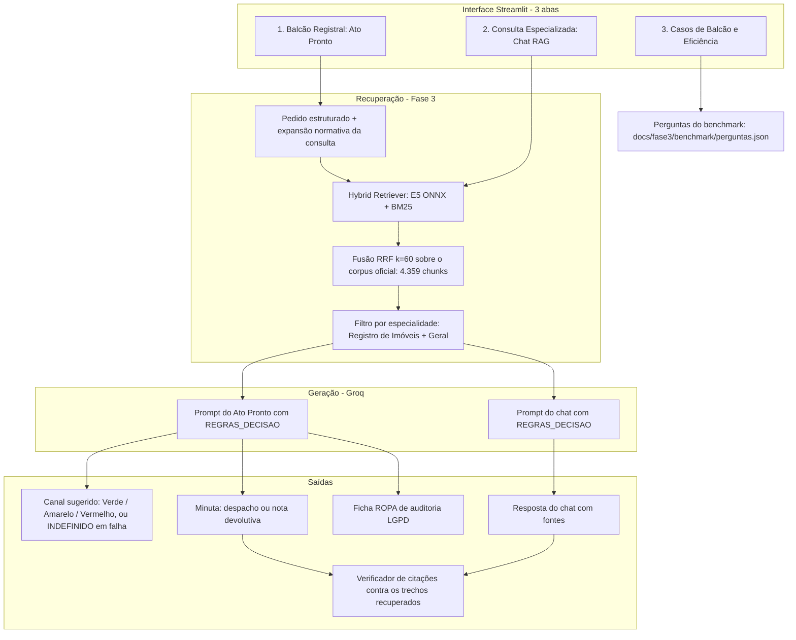

# 🏛️ Assistente Registral CE (`gov-legal-assistant-rag`)

<div align="center">

# 🏛️ Assistente Registral CE
### ⚡ Apoio à decisão operacional, Ato Registral de Balcão & Compliance LGPD
*Especializado em Registro de Imóveis no Ceará (CGJ-CE × Provimento CNJ 149/2023 × Lei 6.015/73)*

<br/>


*Desenvolvido por **Idarlan Magalhães** | Residência SiDi · PPI MoD4* 🎓👋

---

</div>

> 🚨 **A Virada da Fase 3 (Narrow first, build second):** Em resposta ao parecer do Funil Discovery e à Auditoria Cética, o projeto evoluiu de um assistente conversacional horizontal genérico para uma **plataforma vertical de decisão e conformidade registral**. Substituímos a caixa de chat aberta por um **Gerador de Ato Pronto de Balcão**, atacando diretamente os custos, a morosidade e a fricção dos cartórios extrajudiciais.

Antes chamado CartórioSeguro AI. O nome foi alterado porque o sistema produz sugestão de ato, não garantia de conformidade; a decisão e a responsabilidade são do Oficial Registrador.

---

## 🚀 Acesso Rápido & Demonstração Online

* 🌐 **Aplicação Hospedada (Live Demo no Streamlit Cloud):** [Acessar o Assistente Registral CE](https://gov-legal-assistant-rag-ac5upzossehz8hj2zqjzuh.streamlit.app/)
* 📂 **Documentação Completa da Fase 3:** [Ver Documentos da Fase 3](docs/fase3/README.md)
* 📊 **Entregas para a Professora:** [Parecer e Respostas](docs/fase3/07_entregas_professora_zandona.md) | [Entrega Radical e Pensamento Divergente](docs/fase3/06_entrega_radical_e_pensamento_divergente.md)

---

## 🥊 O Problema Real & Por Que os Concorrentes Falham

1. **A Dor no Balcão:** O conflito diário entre o **Princípio da Publicidade Registral** (Art. 17 da Lei 6.015/73) e a **Proteção de Dados Pessoais** (LGPD e Provimento CNJ 149/2023). Quando um terceiro pede certidão com CPF, regime de bens ou filiação de alguém, o escrevente fica no fogo cruzado: se negar indevidamente, comete infração perante a Corregedoria do TJCE; se fornecer na íntegra, expõe o titular e o Oficial do cartório a multas severas da ANPD.
2. **Alternativas atuais (Jus IA, Jurídico AI, ChatGPT):** comparação ainda não medida. Ver [Hipóteses não validadas](#hipóteses-não-validadas).

---

## ⚡ Funcionalidades Implementadas

```
┌────────────────────────────────────────────────────────────────────────────────────────┐
│                                ASSISTENTE REGISTRAL CE                                 │
├────────────────────────────────┬───────────────────────────────────────────────────────┤
│ 1. ATO PRONTO DE BALCÃO        │ O Ato Pronto substitui a conversa livre no fluxo de   │
│    (Analogia da Alfândega)     │ balcão; o chat permanece como consulta de apoio.      │
│                                │ Triagem em 3 cliques com a Analogia da Alfândega:     │
│                                │ Canais Verde, Amarelo e Vermelho.                     │
└────────────────────────────────┴───────────────────────────────────────────────────────┘
```

### 🚦 1. A Analogia da Alfândega (Canais de Risco)
* **🟢 Canal Verde:** deferimento mediante identificação do requerente, sem exigência de finalidade (CGJ-CE Art. 1.128 caput; Prov. CNJ 149/2023 Art. 123).
* **🟡 Canal Amarelo:** deferimento mediante **exigência prévia** de identificação e finalidade, com abertura da ficha do CGJ-CE Art. 1.128 §3º. Sem tarja.
* **🔴 Canal Vermelho:** indeferimento em **nota devolutiva fundamentada** (CGJ-CE Art. 1.128 §4º).

### 🛡️ 2. Tarjador Inteligente & Carimbo Criptográfico SHA-256
No Assistente Registral CE:
* O atendente cola o texto da matrícula (ou carrega o exemplo pré-configurado de Limoeiro do Norte/CE);
* O sistema identifica dados pessoais e gera o texto da certidão;
* Hash SHA-256 de integridade do texto gerado. Não é assinatura digital nem certificação de autenticidade.

---

## 📊 Matriz de *Unfair Advantage* & ROI (Respondendo às Etapas 1 e 6)

| Critério de Avaliação | Fluxo Tradicional (DPO / Manuais) | Assistentes Genéricos (Jus IA / ChatGPT) | **Assistente Registral CE (Fase 3)** |
|:---|:---|:---|:---|
| **Tempo de Decisão** | não medido | não medido | **Latência média de 7,6 s no benchmark interno (25 perguntas, execução de 13/10/2026, híbrido E5+BM25 com filtro de especialidade).** |
| **Interface Operacional** | não medido | não medido | **3 seletores objetivos; o Ato Pronto substitui a conversa livre no fluxo de balcão; o chat permanece como consulta de apoio** |
| **Formato de Saída** | não medido | não medido | **Ato Pronto (Despacho / Nota Devolutiva / ROPA)** |
| **Normas Regionais CE** | não medido | não medido | **Código CGJ-CE + Prov. 15/2026 integrados** |
| **Proteção de Documento** | não medido | não medido | **Tarjador desativado: sem base normativa identificada no corpus** |
| **Custo por Consulta** | não medido | não medido | **< R$ 0,02 via Groq / Modelos Abertos** |

## Hipóteses não validadas

- A validar: "~3,2 segundos no balcão (-93%)" (README) e "3,2 segundos / -93% vs DPO/Chat" e "~3 segundos com veredito pronto" (app).
- A validar: "Redução de 93% no tempo e 98% no custo comprovada em benchmark" (README) e "-98% vs SaaS concorrente" (app).
- A validar: "Aderência Regulatória 100% CGJ-CE / CNJ" (app).
- A validar: "Garantia anti-alucinação" (app).
- A validar: tempo do DPO de "20 a 40 min (ou dias via DPO)" (README) e "20 a 40 minutos (ou dias aguardando DPO)" (app).
- A validar: "Tarjador inteligente inédito" — método de validação: levantamento das funcionalidades do Jus IA, Jurídico AI e similares (documentação, demonstração e teste prático); não se aplica enquanto o tarjador estiver desativado por falta de base normativa.
- A validar: "R$ 150–500/mês por usuário" para os assistentes genéricos — método de validação: coletar preço público ou proposta comercial do Jus IA e do Jurídico AI, com data e fonte.
- A validar: "Nenhum assistente jurídico no Brasil executa a edição do documento para emissão" — método de validação: o mesmo levantamento de funcionalidades dos concorrentes, registrado com data e fonte.
- A validar: "Inovações inéditas" — método de validação: levantamento de mercado com fontes citáveis; até lá, o projeto descreve apenas o que implementa.
- A validar: os assistentes genéricos (Jus IA, Jurídico AI, ChatGPT) "entregam prosa longa e teórica em caixas de chat", "resposta conversacional genérica", "caixa de chat (alta fricção)" — método de validação: rodar as 25 perguntas do benchmark nessas ferramentas e registrar formato da saída (veredito, minuta, fundamentação) na planilha.
- A validar: os assistentes genéricos levam "5 a 10 min (leitura de parecer)" — método de validação: cronometrar escreventes resolvendo 10 casos do benchmark com cada ferramenta.
- A validar: os assistentes genéricos são "desatualizados / foco federal" nas normas do CE e não oferecem proteção de documento — método de validação: notas das colunas "Norma CE" e "Sem alucinação" da rubrica no benchmark.
- A validar: o fluxo tradicional usa "consulta manual e-mail/telefone", "parecer dissertativo", "consulta física ao TJCE", "tarjamento manual na caneta" e tem custo "alto (honorários DPO/SaaS)" — método de validação: entrevistas com 3 cartórios do Vale do Jaguaribe (fluxo atual, tempo e custo por consulta).
- A validar: "Superado" no critério de inovação da rubrica — método de validação: avaliação da banca da residência.

## Limitações conhecidas

- O veredito do semáforo é gerado por LLM e constitui sugestão, não decisão.
- Não há gabarito validado por Oficial ou DPO; "respondida" não significa "correta".
- A taxa de citações verificadas mede ancoragem no contexto recuperado, não correção jurídica do conteúdo.
- Limite de 200 mil tokens/dia no provedor atual (Groq, gpt-oss-20b).
- A funcionalidade de supressão de dados (tarjador) está desativada por ausência de base normativa identificada no corpus do projeto.

---

## 🧱 Arquitetura Técnica



### Acervo Normativo Oficial Indexado (Coleção `fase3` - 4.359 Chunks):
* **Código de Normas Notarial e Registral do Ceará** (CGJ-CE atualizado com Provimento 15/2026);
* **Provimento CNJ 149/2023** (Código Nacional de Normas do Foro Extrajudicial);
* **Lei 6.015/1973** (Registros Públicos compilada sem trechos revogados);
* **Lei 13.709/2018 (LGPD)** e **Lei 12.527/2011 (LAI)**;
* **Resoluções e Guias Oficiais da ANPD** (Agentes de tratamento e segurança da informação).

---

## 🛠️ Como Executar Localmente

### 1. Clonar o Repositório e Instalar Dependências
```bash
git clone https://github.com/idarlandias/gov-legal-assistant-rag.git
cd gov-legal-assistant-rag

# Instalação limpa via uv ou pip
uv sync
# ou: python -m venv .venv && .venv/Scripts/pip install -r requirements.txt
```

### 2. Configurar Variáveis de Ambiente
Copie o arquivo `.env.example` para `.env` e configure seu provider de preferência:
```env
LLM_PROVIDER=groq
GROQ_API_KEY=sua_chave_groq_aqui
CHEAP_MODEL=openai/gpt-oss-20b
PREMIUM_MODEL=openai/gpt-oss-120b
EMBED_MODEL=local
```

### 3. Rodar a Bateria de Testes Automatizados
```powershell
.venv\Scripts\python.exe -m pytest
# Resultado: 137 testes offline passando; os 7 testes de rede dependem da cota do provedor
```

### 4. Iniciar a Aplicação Streamlit
```powershell
.venv\Scripts\streamlit.exe run src/ui/streamlit_app.py
```
Acesse no navegador: `http://localhost:8501`.

---

## 🧪 Estrutura do Repositório

```
gov-legal-assistant-rag/
├── data/
│   ├── chroma/                  # Banco vetorial local (descompactado no boot)
│   ├── chroma_bundle.zip        # Bundle compacto pré-indexado (deploy 1-click)
│   └── corpus_fase3/            # Manifest e fontes oficiais do Ceará/CNJ
├── docs/
│   └── fase3/                   # Documentação completa da virada da Fase 3
│       ├── 01_parecer_professora.md
│       ├── 06_entrega_radical_e_pensamento_divergente.md
│       ├── 07_entregas_professora_zandona.md
│       └── benchmark/           # Planilha e JSON dos 25 casos reais de balcão
├── src/
│   ├── fase3/
│   │   ├── ato_pronto.py        # Motor do Ato Pronto (Pydantic + Canais de Risco)
│   │   ├── tarjador.py          # Tarjador de PII + Carimbo SHA-256
│   │   ├── retrieval.py         # Busca Híbrida E5 (ONNX) + BM25 + RRF
│   │   └── pipeline.py          # Pipeline integrado com prompt da CGJ-CE
│   ├── pipeline/                # Componentes legados (Cache, Routing, CTB Tools)
│   └── ui/
│       └── streamlit_app.py     # Interface moderna com 3 abas e presets
├── tests/                       # 137 testes offline + 7 de rede
├── requirements.txt             # Dependências oficiais para deploy na nuvem
├── pyproject.toml               # Configuração do projeto
└── README.md                    # Este documento
```

---

## 🏆 Alinhamento com a Rubrica da Residência

| Critério | Peso | Status da Entrega |
|:---|:---:|:---|
| **Inovação & Unfair Advantage** | 40% | Gerador de Ato Pronto de Balcão implementado; validação com cartórios pendente. |
| **Engenharia de Software** | 30% | 137 testes offline; 7 testes de rede dependem de cota do provedor. ONNX local e tipagem Pydantic. |
| **Viabilidade & Custos** | 20% | Custo medido: ~R$ 0,004 por consulta (≈1,6 mil tokens de entrada, gpt-oss-120b via Groq, câmbio 5,50). Preço das alternativas de mercado: não medido. |
| **Demonstração & Deploy** | 10% | **Online:** Streamlit Cloud ativo com bundle pré-indexado e presets de 1 clique. |

---

*Desenvolvido para a Residência em Inteligência Artificial SiDi / Prof. Nicksson Freitas.*
