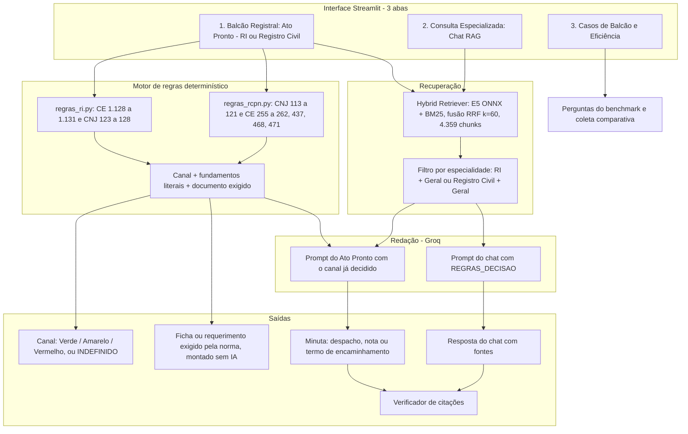

# Assistente Registral CE (`gov-legal-assistant-rag`)

<div align="center">

# Assistente Registral CE
### Assistente de conformidade para o balcão do Registro de Imóveis e do Registro Civil no Ceará
*Aplica, a cada pedido de certidão, as regras de publicidade e proteção de dados do Código de Normas da CGJ-CE e do Provimento CNJ 149/2023. A decisão é do Oficial Registrador.*

<br/>


*Desenvolvido por **Idarlan Magalhães** | Residência SiDi · PPI MoD4*

---

</div>

> **Posicionamento (15/10/2026):** o sistema **não decide e não garante conformidade**. Ele mostra o que a norma exige para o pedido, prepara o documento exigido (ficha ou requerimento) e redige uma minuta. A decisão e a responsabilidade são do Oficial Registrador. O nome antigo, CartórioSeguro AI, foi trocado por esse motivo: o sistema produz sugestão de ato, não garantia de conformidade.

---

## Acesso rápido

* **Aplicação hospedada (Streamlit Cloud):** [Acessar o Assistente Registral CE](https://gov-legal-assistant-rag-ac5upzossehz8hj2zqjzuh.streamlit.app/)
* **Documentação da Fase 3:** [docs/fase3](docs/fase3/README.md) · **Plano de produto:** [doc 18](docs/fase3/18_plano_produto_pos_validacao.md)
* **Validação de campo:** [diário de balcão, conversas e gabarito](data/validacao/README.md)
* **Entregas de ideação para a professora (registro histórico, com nota de retificação):** [doc 07](docs/fase3/07_entregas_professora_zandona.md) · [doc 06](docs/fase3/06_entrega_radical_e_pensamento_divergente.md)

---

## O problema

1. **A dúvida no balcão.** Publicidade dos registros (Lei 6.015/1973, art. 17) e proteção de dados pessoais (LGPD e Provimento CNJ 149/2023, arts. 113 a 128) convivem em regras que mudam conforme três fatores: o tipo de certidão, quem pede e o conteúdo do assento. Errar para um lado expõe dados pessoais; errar para o outro nega a publicidade que a lei garante. O risco concreto para o cartório é **disciplinar**, perante a Corregedoria.
2. **Hipótese ainda não validada:** essa dúvida é frequente o bastante no balcão para justificar uma ferramenta. **Método:** diário de balcão de uma semana em 3 cartórios do Vale do Jaguaribe, separando Registro de Imóveis e Registro Civil.
3. **Alternativas que o cartório já tem:**
   - IAs feitas para cartório: AryaBolt, Sele IA, Notário IA;
   - IAs jurídicas gerais: LegJur AI, Jurídico AI, Jus IA;
   - a própria norma com um checklist;
   - a consulta ao Oficial.

   A comparação ainda não foi medida. A coleta comparativa e a pontuação estão em `data/benchmark/` e `scripts/pontuar_coleta.py`.

---

## O que o sistema faz

| Etapa | O que acontece |
|---|---|
| 1. Pedido | O escrevente escolhe a atribuição (Registro de Imóveis ou Registro Civil), o tipo de certidão e quem pede. Responde só às perguntas que mudam o canal (ex.: há dado sensível no assento?) |
| 2. Regra da norma | Um **motor de regras determinístico** decide o canal a partir de **trechos literais** da norma, conferidos em teste contra o corpus. **RI:** CE 1.128, 1.129 e 1.131 §10; CNJ 123 a 128. **RCPN:** CNJ 113 a 121; CE 255 a 262, 437, 468 e 471. Se faltar a resposta a um fato que muda o canal, nada é decidido |
| 3. Documento exigido | Sem IA, o sistema monta a **ficha de identificação e finalidade** (RI: CE 1.128 §3º / CNJ 128) ou o **requerimento de certidão em inteiro teor** e o **de busca em outras fontes** (RCPN: CNJ 117 §3º e 121, parágrafo único) |
| 4. Minuta | A IA redige a minuta coerente com o canal já decidido. Se ela divergir da regra, o resultado vira INDEFINIDO e a minuta é descartada |
| 5. Conferência | As citações são conferidas contra os trechos recuperados, e a versão de cada norma aparece na barra lateral |

### Canais

| Canal | Registro de Imóveis | Registro Civil das Pessoas Naturais |
|---|---|---|
| 🟢 **Verde** | identificação do requerente, sem exigência de finalidade (CE 1.128 caput; CNJ 123) | sem exigência prévia: breve relato, óbito, busca nos índices (CNJ 113, 118 e 121) |
| 🟡 **Amarelo** | exigência prévia de identificação e finalidade, com a ficha (CE 1.128 §2º e §3º; CNJ 125 a 128) | requerimento escrito (inteiro teor, CNJ 117) ou fundamentado (busca em outras fontes, CNJ 121, parágrafo único) |
| 🔴 **Vermelho** | **nunca decidido pelo sistema**: a recusa é do Oficial, em nota fundamentada (CE 1.128 §4º) | **somente com autorização judicial**, quando a norma a exige (CNJ 114 §1º; CE 471 §2º; CE 437) |
| **Indefinido** | falha, fato não informado ou divergência entre a IA e a regra: decide o Oficial | idem |

Três tipos de pedido do RI não têm regra determinística: exclusão de dados pela LGPD, retificação e pedido de órgão público sem ordem judicial. Neles o canal é **sugestão da IA**, e a tela avisa isso.

---

## O que ainda falta provar

| Prova | Instrumento | Situação |
|---|---|---|
| A dúvida é frequente no balcão (≥ 1 por dia por cartório) | diário de balcão, `scripts/resumir_diario.py` | a coletar |
| As regras acertam a norma | gabarito do registrador (`data/validacao/gabarito_modelo.csv`), `scripts/avaliar_gabarito.py` | 0 de 26 validadas |
| Há vantagem sobre os concorrentes reais | coleta + pontuação em duas camadas | só o RAG próprio pontuado |

## Comparação com as alternativas

| Critério | Fluxo atual (norma, checklist, consulta ao Oficial) | IAs para cartório (AryaBolt, Sele IA, Notário IA) | **Assistente Registral CE** |
|:---|:---|:---|:---|
| Canal decidido por regra da norma com trecho literal | não medido | não anunciado nos sites dos fornecedores (15/10/2026) | sim, no RI e no RCPN |
| Documento exigido pela norma pronto (ficha ou requerimento) | não medido | não anunciado nos sites dos fornecedores (15/10/2026) | sim |
| Acerto contra gabarito de registrador | não medido | não medido | não medido |
| Tempo por pedido | não medido | não medido | latência média de 7,6 s no benchmark interno (25 perguntas, 13/10/2026) |
| Custo | não medido | não medido | ~R$ 0,004 por consulta (Groq, câmbio 5,50) |

## Hipóteses não validadas

- A validar: "~3,2 segundos no balcão (-93%)" (README) e "3,2 segundos / -93% vs DPO/Chat" e "~3 segundos com veredito pronto" (app).
- A validar: "Redução de 93% no tempo e 98% no custo comprovada em benchmark" (README) e "-98% vs SaaS concorrente" (app).
- A validar: "Aderência Regulatória 100% CGJ-CE / CNJ" (app).
- A validar: "Garantia anti-alucinação" (app).
- A validar: tempo do DPO de "20 a 40 min (ou dias via DPO)" (README) e "20 a 40 minutos (ou dias aguardando DPO)" (app).
- A validar: "R$ 150–500/mês por usuário" para os assistentes genéricos — método de validação: coletar preço público ou proposta comercial de cada concorrente, com data e fonte.
- A validar: "Nenhum assistente jurídico no Brasil executa a edição do documento para emissão" e "inovações inéditas" — método de validação: levantamento de funcionalidades das IAs para cartório (demonstração da Sele IA e da Notário IA, teste do AryaBolt), registrado com data e fonte.
- A validar: os assistentes genéricos "entregam prosa longa e teórica em caixas de chat" e levam "5 a 10 min (leitura de parecer)" — método de validação: rodar as perguntas da coleta nesses sistemas e cronometrar escreventes.
- A validar: o fluxo tradicional usa "consulta manual e-mail/telefone", "parecer dissertativo", "consulta física ao TJCE" e tem custo "alto (honorários DPO/SaaS)" — método de validação: diário de balcão e entrevistas com 3 cartórios do Vale do Jaguaribe.
- A validar: "multa da ANPD" como risco do cartório — não há caso registrado de sanção da ANPD a cartório; o risco tratado pelo projeto é o disciplinar.
- A validar: "Superado" no critério de inovação da rubrica — método de validação: avaliação da banca da residência.

## Limitações conhecidas

- Nos tipos de pedido cobertos pelas regras, o canal sai da norma; nos tipos sem regra, é sugestão da IA. Em todos os casos é sugestão ao Oficial, não decisão.
- A tabela de regras transcreve a norma, mas o enquadramento de cada opção da tela ainda não foi validado por um registrador.
- Não há gabarito validado; "respondida" não significa "correta".
- A taxa de citações verificadas mede ancoragem no contexto recuperado, não correção jurídica do conteúdo.
- As 25 perguntas do benchmark são de Registro de Imóveis; falta um conjunto de casos de Registro Civil.
- Limite de 200 mil tokens/dia no provedor atual (Groq, gpt-oss-20b).
- A funcionalidade de supressão de dados (tarjador) está fora da interface por ausência de base normativa no corpus do projeto; o módulo permanece no repositório.

---

## 🧱 Arquitetura Técnica



### Acervo Normativo Oficial Indexado (Coleção `fase3` - 4.359 Chunks):
* **Código de Normas Notarial e Registral do Ceará** (CGJ-CE atualizado com Provimento 15/2026);
* **Provimento CNJ 149/2023** (Código Nacional de Normas do Foro Extrajudicial);
* **Lei 6.015/1973** (Registros Públicos compilada sem trechos revogados);
* **Lei 13.709/2018 (LGPD)** e **Lei 12.527/2011 (LAI)**;
* **Resoluções e Guias Oficiais da ANPD** (Agentes de tratamento e segurança da informação).

---

## 🛠️ Como Executar Localmente

### 1. Clonar o Repositório e Instalar Dependências
```bash
git clone https://github.com/idarlandias/gov-legal-assistant-rag.git
cd gov-legal-assistant-rag

# Instalação limpa via uv ou pip
uv sync
# ou: python -m venv .venv && .venv/Scripts/pip install -r requirements.txt
```

### 2. Configurar Variáveis de Ambiente
Copie o arquivo `.env.example` para `.env` e configure seu provider de preferência:
```env
LLM_PROVIDER=groq
GROQ_API_KEY=sua_chave_groq_aqui
CHEAP_MODEL=openai/gpt-oss-20b
PREMIUM_MODEL=openai/gpt-oss-120b
EMBED_MODEL=local
```

### 3. Rodar a Bateria de Testes Automatizados
```powershell
.venv\Scripts\python.exe -m pytest
# Resultado: 215 testes offline passando; os 7 testes de rede dependem da cota do provedor
```

### 4. Iniciar a Aplicação Streamlit
```powershell
.venv\Scripts\streamlit.exe run src/ui/streamlit_app.py
```
Acesse no navegador: `http://localhost:8501`.

---

## 🧪 Estrutura do Repositório

```
gov-legal-assistant-rag/
├── data/
│   ├── chroma/                  # Banco vetorial local (descompactado no boot)
│   ├── chroma_bundle.zip        # Bundle compacto pré-indexado (deploy 1-click)
│   ├── corpus_fase3/            # Manifest e fontes oficiais do Ceará/CNJ
│   ├── benchmark/               # Coleta comparativa (respostas, perguntas, ordem)
│   └── validacao/               # Diário de balcão, roteiro de conversas e gabarito
├── docs/
│   └── fase3/                   # Documentação completa da virada da Fase 3
│       ├── 01_parecer_professora.md
│       ├── 06_entrega_radical_e_pensamento_divergente.md
│       ├── 07_entregas_professora_zandona.md
│       └── benchmark/           # Planilha e JSON dos 25 casos reais de balcão
├── src/
│   ├── fase3/
│   │   ├── ato_pronto.py        # Ato Pronto: regra da norma + minuta da IA + documento exigido
│   │   ├── regras_ri.py         # Motor de regras do Registro de Imóveis (trechos literais)
│   │   ├── regras_rcpn.py       # Motor de regras do Registro Civil (trechos literais)
│   │   ├── tarjador.py          # Fora da interface (sem base normativa no corpus)
│   │   ├── retrieval.py         # Busca Híbrida E5 (ONNX) + BM25 + RRF
│   │   └── pipeline.py          # Pipeline integrado com prompt da CGJ-CE
│   ├── pipeline/                # Componentes legados (Cache, Routing, CTB Tools)
│   └── ui/
│       └── streamlit_app.py     # Interface moderna com 3 abas e presets
├── tests/                       # 215 testes offline + 7 de rede
├── requirements.txt             # Dependências oficiais para deploy na nuvem
├── pyproject.toml               # Configuração do projeto
└── README.md                    # Este documento
```

---

## 🏆 Alinhamento com a Rubrica da Residência

| Critério | Peso | Status da Entrega |
|:---|:---:|:---|
| **Inovação & Unfair Advantage** | 40% | Motor de regras com trechos literais da norma (RI e Registro Civil) e documentos exigidos montados sem IA; validação com cartórios pendente. |
| **Engenharia de Software** | 30% | 215 testes offline; 7 testes de rede dependem de cota do provedor. ONNX local e tipagem Pydantic. |
| **Viabilidade & Custos** | 20% | Custo medido: ~R$ 0,004 por consulta (≈1,6 mil tokens de entrada, gpt-oss-120b via Groq, câmbio 5,50). Preço das alternativas de mercado: não medido. |
| **Demonstração & Deploy** | 10% | **Online:** Streamlit Cloud ativo com bundle pré-indexado e presets de 1 clique. |

---

*Desenvolvido para a Residência em Inteligência Artificial SiDi / Prof. Nicksson Freitas.*
